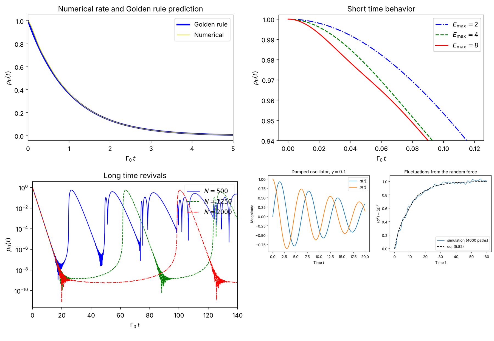

# Numerical Modelling of Some Quantum Systems

Python code for the numerical simulations in the master thesis

> Eva Obeed, *Numerical Modelling of Some Quantum Systems*,
> Thesis for the degree of Master in Physics,
> Norwegian University of Science and Technology (NTNU), Department of Physics,
> Trondheim, May 2016. Supervisor: Kåre Olaussen.

The thesis studies how different formulations of quantum mechanics can be modelled and solved numerically. This repository contains a Python 3 implementation of its simulations, built on NumPy and SciPy.

## Contents

| File | Thesis sections | Description |
|---|---|---|
| `matrix_mechanics.py` | 2.4.1, 4.1, 6.1 | Heisenberg matrix mechanics with finite N × N matrices; (an)harmonic oscillators in 1, 2 and 3 dimensions |
| `two_level_atom.py` | 4.2, 6.2 | Decay of a two-state atom coupled to photon modes, compared with the Fermi Golden Rule |
| `langevin.py` | 5.5, 5.6, 6.3–6.5 | Classical damped oscillators with a random force (Langevin equations) and a linear harmonic chain |

## Installation

Python 3.8 or newer is required.

```bash
git clone https://github.com/<username>/<repository>.git
cd <repository>
pip install -r requirements.txt
```

## Usage

Each module runs on its own and prints its results. Figures are written to a `figures/` folder.

```bash
python matrix_mechanics.py
python two_level_atom.py
python langevin.py
```

The classes can also be imported:

```python
from matrix_mechanics import MatrixQM
from two_level_atom import TwoLevelAtom
import numpy as np

# Lowest levels of H = p^2 + q^4
qm = MatrixQM(N=50, b2=0, b4=1)
print(qm.spectrum(k=5))

# Survival probability of the excited atom
atom = TwoLevelAtom(N=1000, lamda=0.1, Ea=1.0, Emax=8.0)
t = np.linspace(0, 80, 400)
p0 = atom.survival_probability(t)
```

## The models

Units are chosen so that ħ = 1 and mω = 1. The reference Hamiltonian is H₀ = p² + q² (no factor ½), so the harmonic oscillator levels are Eₙ = 2n + 1.

### 1. Matrix mechanics (`matrix_mechanics.py`)

The infinite matrices for position q and momentum p in the harmonic oscillator basis are replaced by N × N real matrices. The module covers:

- **Commutator check.** [q, ip] = −1 holds except in the last diagonal element, because the commutator of finite matrices must be traceless.
- **Diagonalization.** Accuracy and timing of `scipy.linalg.eigh` (dense) and `scipy.sparse.linalg.eigsh` (iterative, using only the action of H on a vector).
- **Discrete Schrödinger representation.** For a general potential V(q), the matrix q is diagonalized so that V becomes diagonal: `discrete_schrodinger(V, N)`.
- **Oscillators in D dimensions.** The class `MatrixQM` handles Hamiltonians of the form

  ```
  H = Σ_j [ a2_j p_j² + b2_j q_j² + b4_j q_j⁴ ]  +  Σ_{j<k} b22_jk q_j² q_k²
  ```

  The Hamiltonian is never stored as a matrix in higher dimensions; it acts on a D-index array through NumPy slicing. Each parity sector is solved separately, with dense diagonalization for small systems and `eigsh` for large ones.

### 2. Decay of a two-state atom (`two_level_atom.py`)

An excited two-level atom is coupled to N + 1 equally spaced photon modes. In the one-excitation sector the Hamiltonian is an (N + 2) × (N + 2) arrowhead matrix. The Schrödinger equation is solved by full diagonalization, which gives the survival probability p₀(t) of the excited state. Three regimes are shown:

- **Exponential decay,** in agreement with the Golden Rule rate Γ₀ = 2πλ².
- **Short times,** where the decay is quadratic in t rather than exponential.
- **Long times,** where the excited state revives after a time proportional to N.

### 3. Langevin equations (`langevin.py`)

Linear stochastic equations dz/dt + D z = F(t) are solved through the eigen-decomposition of the dynamical matrix D:

- The mean path and the covariance of the fluctuations are evaluated from closed formulas.
- An ensemble simulation with an exact time step confirms the covariance formula.
- A chain of coupled oscillators with random masses and spring constants, connected to a heat bath at one end, relaxes to equipartition.

This part was left unfinished in the thesis; the code completes it along the lines described in the text.

## Results

| Quantity | Value |
|---|---|
| Ground state of p² + q⁴ | 1.06036209048418 (converged at N = 40) |
| Ground state of p² + q⁴ in 3D (N = 20 per direction) | 3.1810862718 (three times the 1D value) |
| Atomic decay rate, numerical fit | 0.0636 |
| Atomic decay rate, Golden Rule | 0.0628 |
| Stationary ⟨q²⟩ of the forced oscillator, simulated | 1.001 (exact value 1) |



## Relation to the thesis listings

The thesis appendices list the original programs (`MatrixMechanicsDemo.py`, `WaveMechanicsDemo.py`, `MatrixQM.py`, `useMatrixQM.py`, `TwoLevelAtom.py`, `DynamicalLattice.py`). The code here is a rewrite for Python 3 and current NumPy/SciPy based on the equations in the text, organized into three self-contained modules.

## Citation

```bibtex
@mastersthesis{obeed2016numerical,
  author  = {Eva Obeed},
  title   = {Numerical Modelling of Some Quantum Systems},
  school  = {Norwegian University of Science and Technology (NTNU)},
  address = {Trondheim, Norway},
  year    = {2016},
  month   = {May}
}
```

## Author

Eva Obeed
